# SDN & Cloud Intelligent — AI-Assisted Network Congestion Monitoring

**Software-Defined Networking · Mininet · Ryu · OpenFlow · Ansible · Random Forest · Real-Time Dashboard**

Academic project (2025–2026) — National Engineering School of Tunis (ENIT)  
**Project team:** Sana Mkaouar and Arij Bouazizi  
**Supervisor:** Ms Mariem Kassar

## Overview

This project explores an intelligent Software-Defined Networking (SDN) environment that combines a **Fat-Tree data-center topology**, programmable network control, network automation, and machine-learning-based congestion prediction. A Ryu OpenFlow controller manages traffic forwarding, while a separate data-collection and AI pipeline monitors the network and displays congestion indicators on a live dashboard.

> **Repository note:** This README documents the architecture and demonstrations shown in the project presentation. The source scripts, model artifacts, and configuration files are not included in this documentation-only package.

## Network architecture

Two virtual machines separate network emulation from SDN control and AI processing:

- **Mininet VM:** emulates the switches, hosts and links in the Fat-Tree topology.
- **Ryu Controller VM:** runs the remote OpenFlow controller and AI/monitoring modules.

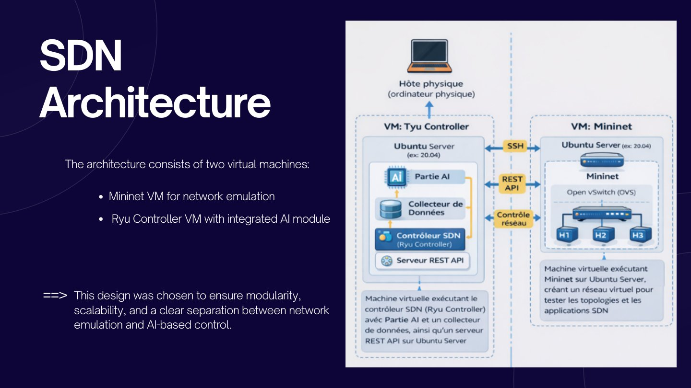

### Project components

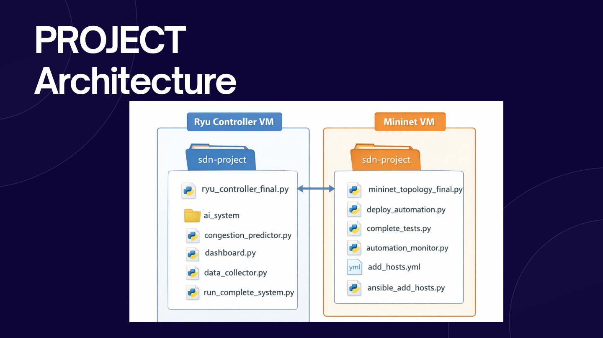

### Fat-Tree topology (k = 4)

The emulated topology comprises **4 core switches, 8 aggregation switches, 8 edge switches and 16 hosts**.

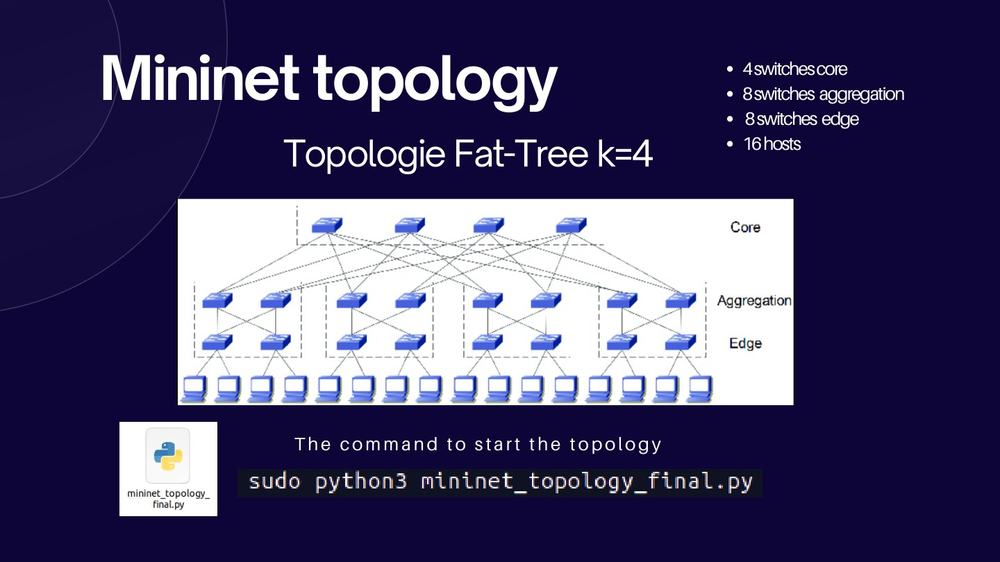

## Key features

| Area | Implementation demonstrated |
| --- | --- |
| Network emulation | Mininet Fat-Tree k=4 topology |
| Programmable control | Remote Ryu controller acting as an L2 learning switch |
| Traffic forwarding | MAC learning and OpenFlow forwarding rules |
| Network validation | Automated bandwidth, latency, UDP and OpenFlow tests |
| Monitoring | Periodic switch/flow/controller checks, every 5 seconds |
| Automation | Ansible playbook for adding Mininet hosts and assigning IP/MAC addresses |
| AI-assisted analysis | Random Forest-based classification of normal vs. congested states |
| Visualization | Live dashboard with per-switch metrics and congestion alerts |

## Automated deployment and network tests

The Fat-Tree environment is launched by a Python script that checks connectivity to the controller, cleans any previous Mininet state and starts the interactive Mininet CLI.

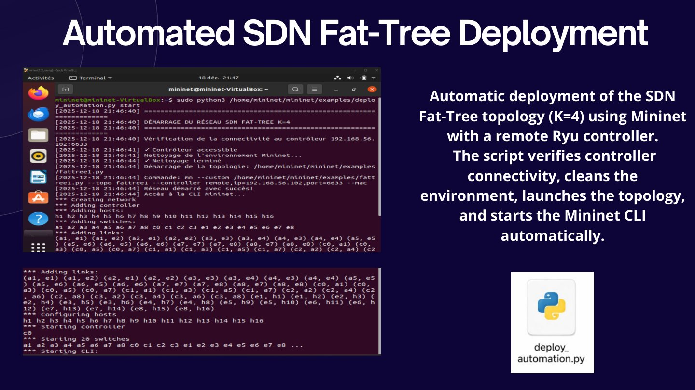

A separate automated testing workflow runs sequential connectivity, bandwidth, latency, UDP traffic and OpenFlow checks and produces a structured report.

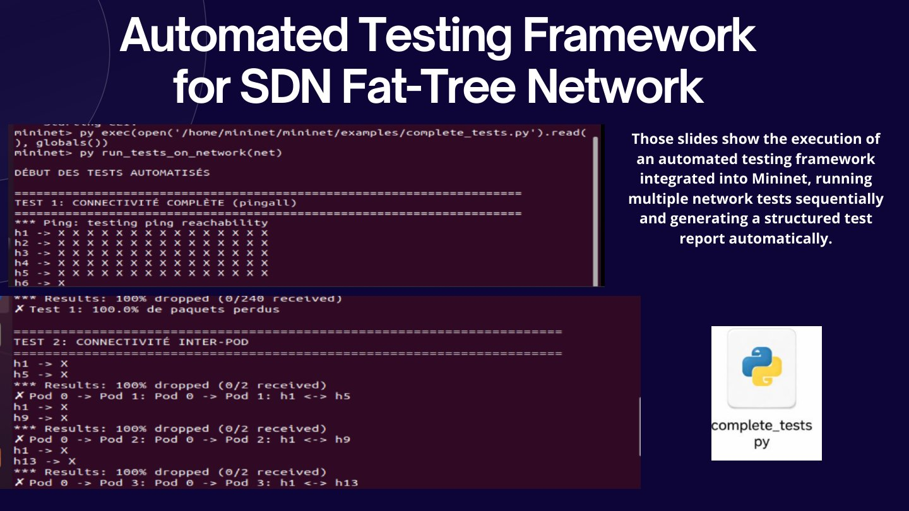

## SDN controller and monitoring

The **Ryu L2 learning-switch controller** learns source MAC addresses, installs OpenFlow rules and reduces unnecessary network flooding. A monitoring utility checks network and controller state at approximately five-second intervals.

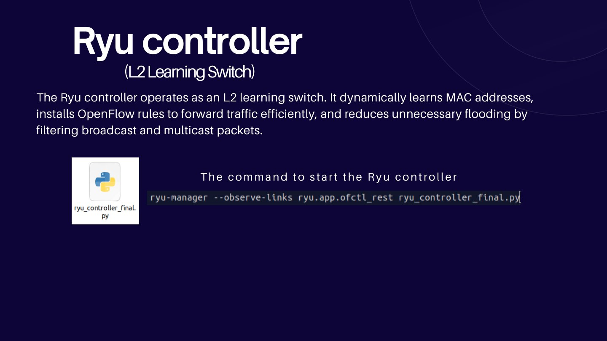

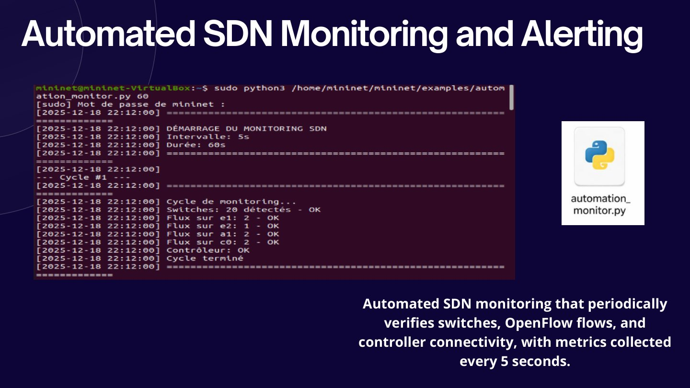

## Network automation with Ansible

The `add_hosts.yml` playbook generates a Python script for Mininet that adds hosts to appropriate edge switches, assigns IP/MAC addresses and performs initial connectivity checks.

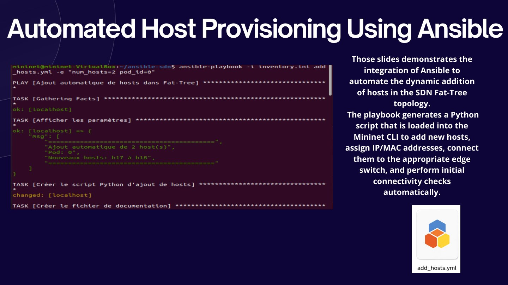

## AI-driven congestion prediction

The demonstrated prediction pipeline contains these components:

| File | Role |
| --- | --- |
| `data_collector.py` | Collects network metrics from the emulated network |
| `congestion_predictor.py` | Applies Random Forest to classify normal or congested traffic |
| `dashboard.py` | Shows live measurements, predictions and alerts |
| `run_complete_system.py` | Launches collection, prediction and visualization together |

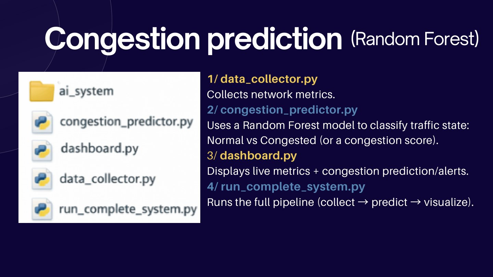

The collector communicates with the Ryu controller and gathers metrics from the switches. The dashboard reports network-wide health and per-switch traffic characteristics.

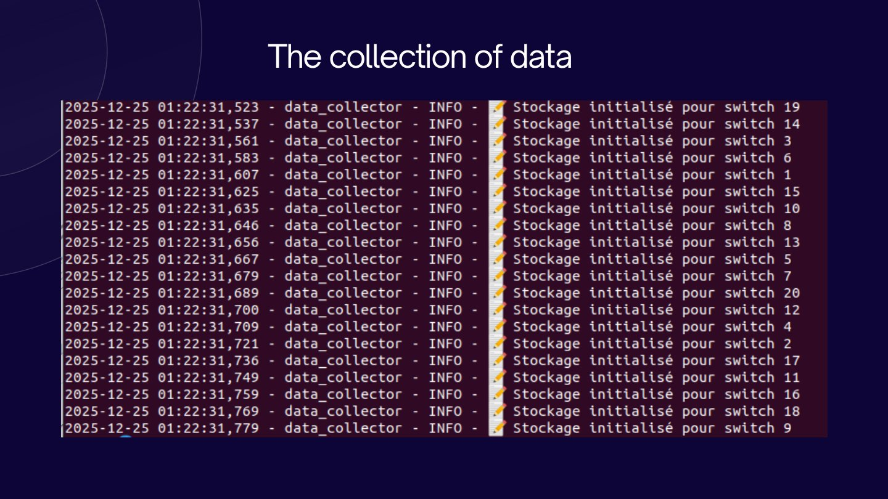

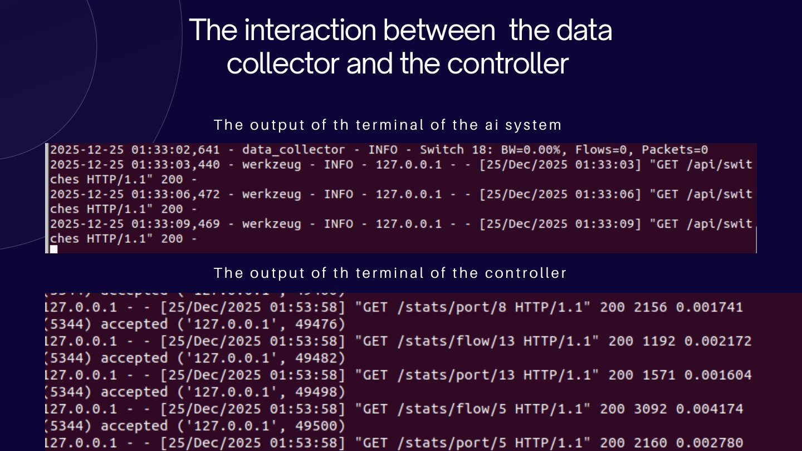

### Demonstration: normal traffic

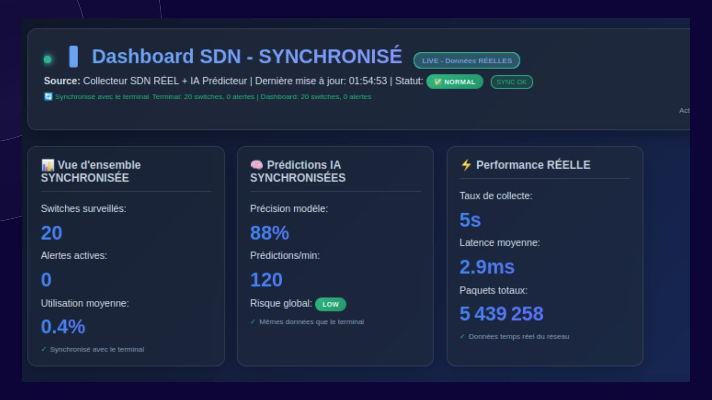

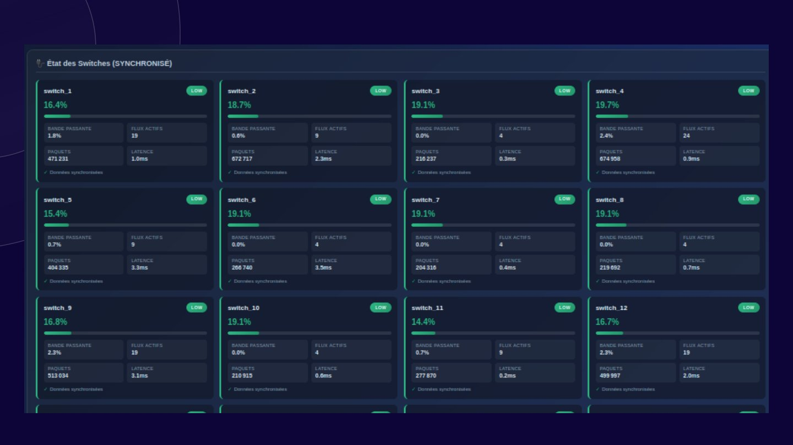

### Demonstration: congested traffic

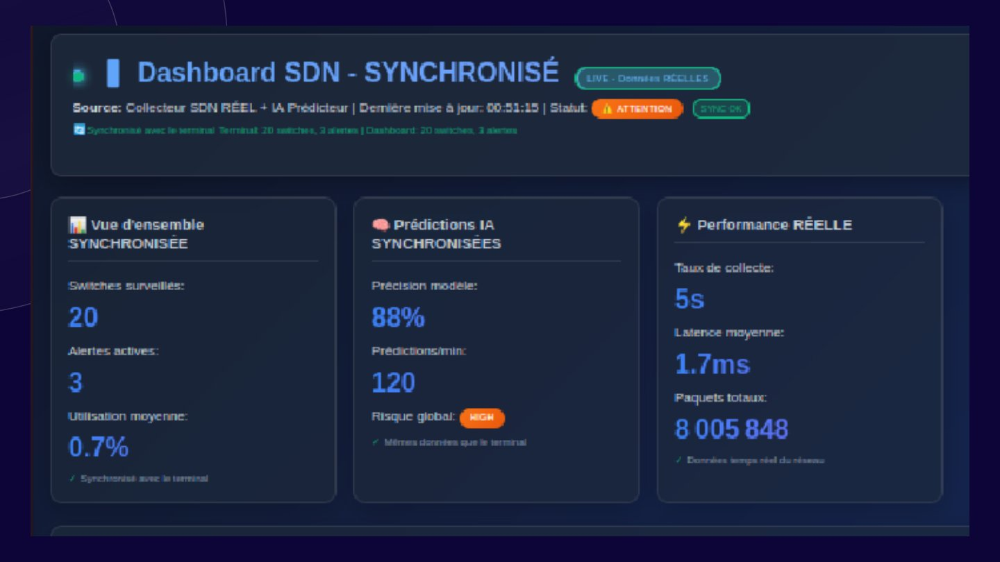

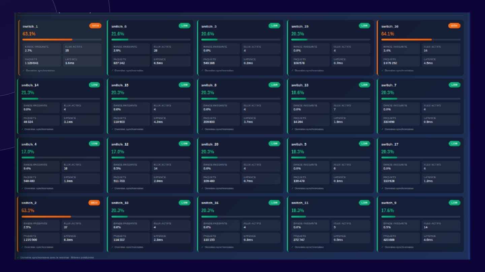

These screenshots illustrate the dashboard's behavior in the two test conditions. They do **not** establish a numerical model-accuracy benchmark; no independent accuracy, precision or recall results were supplied in the presentation.

## Running the original project

The presentation shows the following entry points **when the original source files, dependencies and VM configuration are available**:

```bash
# On the Mininet VM: start the Fat-Tree topology
sudo python3 mininet_topology_final.py

# On the controller / AI VM: run the complete AI workflow
python3 run_complete_system.py
```

The Ryu controller must also be started with the project's own controller script and configuration. These commands are illustrative of the presented setup; they are not a complete installation procedure. The actual source files are needed to run the system.

## Technologies

**SDN and networking:** Mininet, Ryu, OpenFlow, Fat-Tree topology  
**Automation:** Python, Ansible  
**AI and analytics:** Random Forest, network metrics collection, real-time dashboard  
**Testing:** bandwidth/latency, UDP traffic and OpenFlow validation

## Project outcomes

- Designed and demonstrated a programmable SDN environment based on a 20-switch / 16-host Fat-Tree network.
- Automated topology startup, testing and dynamic host provisioning.
- Combined periodic controller monitoring with an AI-based normal/congested traffic classification workflow.
- Visualized per-switch conditions and network alerts through a synchronized dashboard.

## Documentation

This repository documentation is based on the presentation **“SDN & Cloud Intelligent” (2025–2026)**. The images in `docs/images/` are exported from that presentation.

---

**Authors:** Sana Mkaouar & Arij Bouazizi · **Supervisor:** Ms Mariem Kassar · **ENIT**
